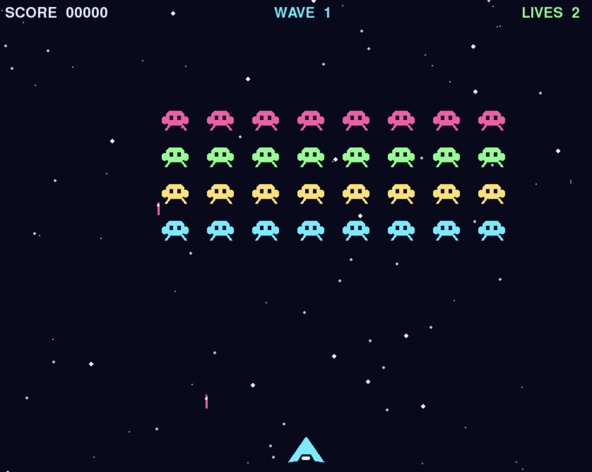

# Space Invaders: Python Modules Lab

# CS101 Fall 2026: Lab 05

🚀 In this assignment, you will practice creating and using Python modules by completing a small arcade game. The starter code is organized into a `src/space_invaders/` package. Some files and functions are already complete; others have numbered To-Dos and hints. Follow the To-Dos in order, run the game as you make progress, and complete the reflection questions.

## Assigned and Due

- **Assigned:** Friday, November 6, 2026 at 2:30 p.m.
- **Due:** Friday, November 13, 2026 at 2:30 p.m.
- **Expiration:** Friday, November 20, 2026 at 2:30 p.m.

The expiration date is the last date work may be submitted for a grade.



## Learning Objectives

By the end of this assignment, you will be able to:

- Explain what a Python module is and organize a program into related modules.
- Import standard-library, third-party, and locally written modules.
- Use package-relative imports to connect modules in a `src/` package.
- Explain the purpose of a module docstring and the `if __name__ == "__main__":` guard.
- Use `uv` to install a project dependency and run a Python application.
- Implement and test functions and methods in more than one module.

## Getting Started

Install `uv` if needed: <https://docs.astral.sh/uv/getting-started/installation/>

From the project directory, install the declared dependencies:

```bash
uv sync
```

Try to start the game. It is intentionally incomplete; the errors and the numbered To-Dos are clues:

```bash
uv run space-invaders
```

After you finish the To-Dos, use the same command to play.

## Game Controls

- **Enter** or **Space:** start the game
- **Left/Right arrows** or **A/D:** move
- **Space:** fire
- **R:** restart after game over
- **Escape:** quit

Clear each wave of invaders while avoiding their shots. The ships and starfield are drawn by Pygame; no external image assets are needed.

## Project Layout

```text
pyproject.toml
src/
  space_invaders/
    __init__.py
    background.py
    config.py
    enemy.py
    game.py
    main.py
    player.py
    projectile.py
writing/
  reflection.md
```

Each `.py` file is a module. `game.py` will coordinate the modules, while focused modules define the player, invaders, projectiles, background, and shared settings. Do not put the entire game in `main.py`.


## To-Do Roadmap

- Be sure to complete these tasks in their proper order. 
- Run the program after each small group of changes and then use the traceback to locate any errors that may result.

### Phase 1: Import and package setup

1. **To-Do 1 — Entry-point import:** In `main.py`, import `Game` from the local `game` module using a package-relative import.
2. **To-Do 2 — Game imports:** In `game.py`, import the local `Starfield`, `Invader`, `Player`, and `Projectile` definitions. The game module needs each of these names.
3. **To-Do 3 — Player import:** In `player.py`, import `Projectile` from the local projectile module. Avoid `from ... import *`.

### Phase 2: Build the reusable modules

4. **To-Do 4 — Starfield module:** In `background.py`, use the provided `random` import. First create stars as four-value lists `[x, y, radius, speed]`; then update their y positions and wrap stars that pass the bottom; finally draw each as a circle. The TODOs include the indexes and Pygame function to use.
5. **To-Do 5 — Projectile method:** In `projectile.py`, change `position_y` by `velocity_y * delta_seconds`, copy the rounded value to `rect.y`, and remove the projectile with `self.kill()` when it is above or below the window.
6. **To-Do 6 — Invader class:** In `enemy.py`, create the transparent Surface, select a color using `row % len(colors)`, draw a simple body and eyes, and create its rectangle at `(x, y)`. Each small step is listed in the TODO.
7. **To-Do 7 — Player methods:** In `player.py`, use the `keys[key]` values to detect left/right movement, calculate a direction of -1, 0, or 1, and limit the ship to the window. For firing, compare the time since `last_shot` to the cooldown; return `None` if it is too soon, otherwise return the shown `Projectile`.

### Phase 3: Connect modules into a game

8. **To-Do 8 — Formation:** The two calculation lines are already in `game.py`. Read them and check the arithmetic: `formation_width` is `config.ENEMY_COLUMNS * 64`, then the left edge is `(config.WIDTH - formation_width) // 2`. The parentheses make sure subtraction happens before integer division. The two loops create each row and column.
9. **To-Do 9 — Events:** In `_handle_events`, use this shape:

   ```python
   for event in pygame.event.get():
       if event.type == pygame.QUIT:
           # quit
       elif event.type == pygame.KEYDOWN:
           # check event.key here
   ```

   First handle window close and Escape. Enter or Space starts the title screen. For firing, call `self.player.shoot(pygame.time.get_ticks())` and only add the returned value if it is not `None`. When the game is over, R calls `self.reset_round()` and starts the game again. Use `pygame.K_ESCAPE`, `pygame.K_RETURN`, `pygame.K_SPACE`, and `pygame.K_r` for the key constants.
10. **To-Do 10 — Game update:** Implement this in the listed order:
    - Update held-key movement with `pygame.key.get_pressed()`, then call `.update(delta_seconds)` on each projectile group.
    - Move each enemy by `self.enemy_direction * speed * delta_seconds`. Use the speed hint in the code comments. Find the formation edges with `min(enemy.rect.left for enemy in self.enemies)` and `max(enemy.rect.right for enemy in self.enemies)`. At an edge, reverse the direction and move all enemies down.
    - Add elapsed time to `enemy_shot_timer`. When it reaches `ENEMY_SHOT_INTERVAL`, reset it, select an invader with `random.choice(self.enemies.sprites())`, and add one downward projectile. Check that the enemy group is not empty first.
    - Call `pygame.sprite.groupcollide(...)` for player shots versus enemies. It returns a dictionary; add `10 * len(hits)` to the score. Call `pygame.sprite.spritecollide(...)` for enemy shots versus the player; if the returned list is not empty, subtract one life.
    - If lives reach zero, set `game_over`. If the enemies are all gone and the game is not over, add one to the wave and call `_create_formation()`.

    The TODO comments in `_update_game` label these steps 10a–10e. Complete and test one step before moving to the next.
11. **To-Do 11 — Draw the game:** Build one frame in order: fill the background, draw stars, draw active sprites and HUD during play, show title/controls before play, show the game-over text when needed, and call `pygame.display.flip()` last. Use the existing `_draw_hud` and `_draw_centered` helper methods instead of building text rendering from scratch.

### Phase 4: Verify and reflect

12. Check your imports and confirm the application starts using the command below.
13. Play a full round: move, shoot, get hit, clear a wave if you can, and restart after game over.
14. Complete all eight questions in `writing/reflection.md`, referring to specific modules or imports in your own project.


## Module Hints

- A module is one `.py` file. The `space_invaders` directory is a package because it contains `__init__.py`.
- A package-relative import begins with a dot, for example: `from .config import WIDTH`.
- Use `import random` when you want calls such as `random.choice(...)` to show where they came from.
- `pygame-ce` is the package installed by `uv`; Python code imports it with the name `pygame`.
- For sprite groups, use `group.update(delta_seconds)` to update every sprite and `group.draw(surface)` to draw them.
- `pygame.sprite.groupcollide(first_group, second_group, True, True)` removes colliding sprites and returns a dictionary; `len(the_dictionary)` is the number of invaders hit.
- `pygame.sprite.spritecollide(player, shots, True)` returns a list of shots that hit the player. The final `True` removes those shots.
- `pygame.key.get_pressed()` gives the current held-key states; `pygame.event.get()` gives one-time events such as key presses and window close.
- Prefer importing only the module or names that you use. Avoid wildcard imports.
- Keep each module focused. The game loop should coordinate behavior, not duplicate every sprite's implementation.
- `if __name__ == "__main__":` prevents an entry point from running automatically when imported.


## Running and Submitting

Run the game:

```bash
uv run space-invaders
```

As you work, commit and push regular, meaningful changes to your GitHub repository. Submit:

1. The completed `src/space_invaders/` modules with all To-Dos resolved.
2. A playable game that starts with `uv run space-invaders`.
3. `writing/reflection.md` with all eight questions answered in your own words.

Before submitting, search `src/` for `To-Do` and test the controls above.


## Submission

🚀 As you are working on your lab, you are to commit and push regularly. The commands are the following.

```bash
git add -A
git commit -m ``Your notes about commit here''
git push
```

**Super Important Advice!**

After you have pushed your work to your repository, please visit the repository at the GitHub website (you may have to log-in using your browser) to verify that your files were correctly sent.


## Project Assessment

The grade that a student receives on this assignment will have the following components.

* **Mastery of Technical Writing [up to 25%]:**: Students will also receive a checkmark grade when the responses to the writing questions presented in the `reflection.md` reveal a proficiency of both writing skills and technical knowledge. To receive a checkmark grade, the submitted writing should have correct spelling, grammar, and punctuation in addition to following the rules of Markdown and providing conceptually and technically accurate answers.

* **Mastery of Technical Knowledge and Skills [up to 75%]**: Students will receive a portion of their assignment grade when their program implementation reveals that they have mastered all of the technical knowledge and skills developed during the completion of this assignment. As a part of this grade, the instructor will assess aspects of the programming including, but not limited to, the completeness and the correctness of the program and the use of effective source code comments.

## Seeking Assistance

Students who have questions about this project outside of the lab time are invited to ask them in the course's Discord channel or during instructor's or TL's office hours.
